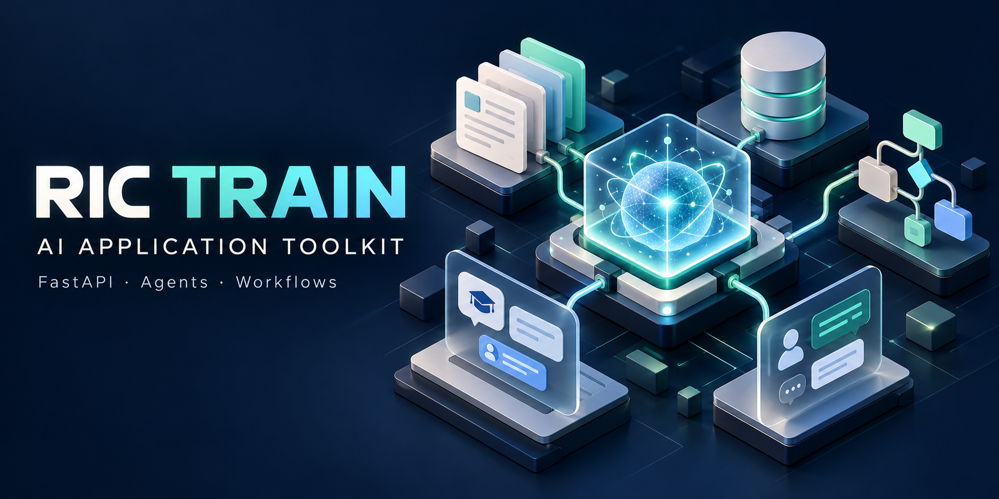
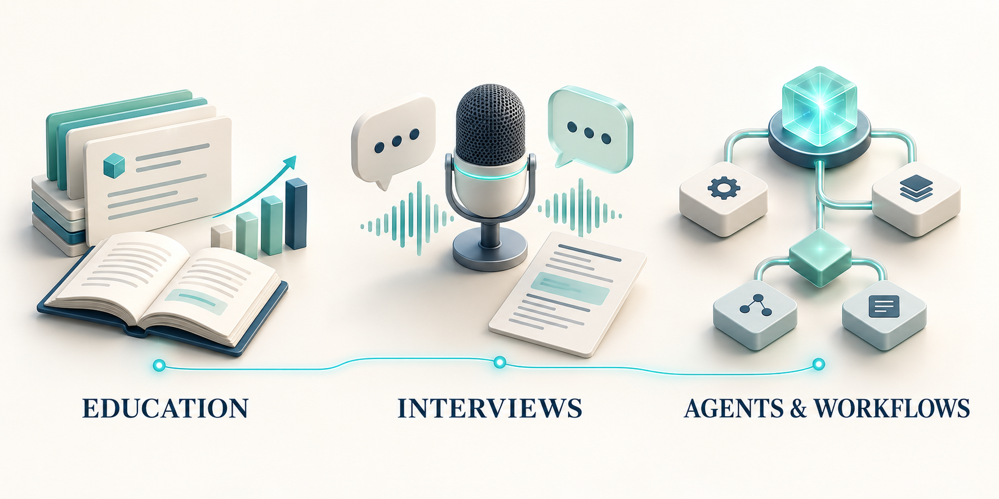
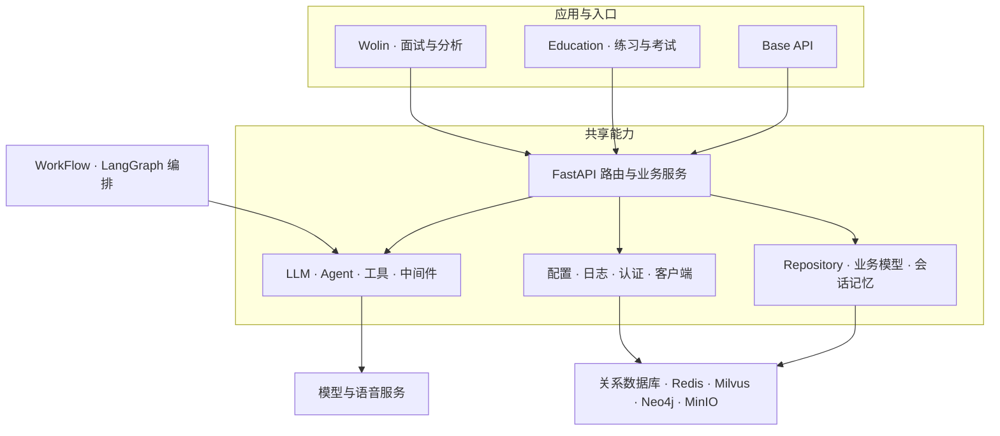

<p align="center">
  
</p>

<h1 align="center">RIC TRAIN</h1>

<p align="center"><strong>基于 FastAPI 的 AI 应用开发脚手架</strong><br />
把模型调用、Agent、数据访问与业务应用组织在同一套 Python 工程中。</p>

<p align="center">
  
  
  
  
</p>

<p align="center">
  <a href="#项目概览">项目概览</a> ·
  <a href="#核心能力">核心能力</a> ·
  <a href="#架构与目录">架构与目录</a> ·
  <a href="#快速开始">快速开始</a> ·
  <a href="#开发与部署">开发与部署</a> ·
  <a href="#文档导航">文档导航</a>
</p>

## 项目概览

RIC TRAIN 面向需要将大模型接入实际业务的 Python 开发者。项目将通用能力沉淀在 `Base` 中，并提供教育练习与考试、面试对话与分析两个业务方向，以及基于 LangGraph 的工作流封装，便于从现有模块出发扩展自己的应用。

| 模块 | 定位 | 已有内容 |
| --- | --- | --- |
| **Base** | 共享基础层 | LLM 接入、Agent 与工具调用、认证与角色菜单、数据仓储、缓存、对象存储、日志及定时任务 |
| **Education** | 教育应用 | 题库、试卷、在线考试、答题记录、用户画像、Agent 聊天，以及 HTML / React 页面 |
| **Wolin** | 面试应用 | 面试题目、对话与记录管理、音频处理、面试分析，以及用户端和管理端 React 工程 |
| **WorkFlow** | 流程编排 | 状态定义、节点注册、串行与并行节点、条件分支，以及图编译封装 |

这是一个持续演进的应用开发仓库。不同入口会使用不同的模型服务和数据服务；完整运行前需要配置相应依赖。



<p align="center"><sub>能力概念插图，非产品界面截图。</sub></p>

## 核心能力

### 统一的模型与 Agent 开发接口

- **模型封装**：提供 Qwen、DeepSeek 实现，以及同步、异步和流式调用接口。
- **多模态能力**：包含 Embedding、OCR、ASR 等接口封装，具体可用能力取决于模型实现和配置。
- **Agent 范式**：提供 ReAct、CoT、Plan-and-Execute 实现及工具注册机制。
- **中间件扩展**：包含日志、指标、安全检查与评估组件，可组合到 Agent 调用链中。

### 从对话到业务数据

- **会话记忆**：结合近期对话、会话信息与向量相似度召回组织上下文。
- **知识与检索**：包含 Milvus 向量模型、Neo4j 客户端和自然语言转 Cypher 的 Agent 实现。
- **数据仓储**：提供 MySQL、PostgreSQL、SQLite 连接实现，以及基于 Pydantic 的业务模型和连接管理器。
- **基础服务**：封装 Redis、MinIO、语音处理、邮件和文件工具，减少业务模块中的重复接入代码。

### 可复用的应用工程

- **业务分层**：API、Service、Model、Repository 按职责组织，公共能力与业务应用分开维护。
- **配置管理**：通过 Pydantic Settings 读取项目根目录的 `.env`。
- **日志管理**：同一进程中的重复、并发 `setup_logging()` 调用仅初始化一次；控制台、常规日志和错误日志分别输出，文件按天轮转并使用 PID 区分进程。
- **应用入口**：Base、Education、Wolin 可分别启动，按需使用对应的后端接口和前端工程。

## 架构与目录



```text
ric-train/
├── Base/
│   ├── Ai/                 # LLM、Agent、工具和中间件
│   ├── Api/                # 聊天、认证等公共 API
│   ├── Client/             # 数据库、缓存、存储和外部服务客户端
│   ├── Config/             # 环境配置与日志初始化
│   ├── Models/             # 公共业务模型
│   ├── Repository/         # 连接管理、数据模型和仓储基础类
│   ├── RicUtils/           # 文件、音频、HTTP 等工具
│   ├── Service/            # 公共业务服务与定时任务
│   └── main.py             # 公共 API 入口
├── Education/              # 教育应用、API 与前端
├── Wolin/                  # 面试应用、API 与前端
├── WorkFlow/               # LangGraph 工作流封装
├── assets/readme/          # README 插图与生成说明
├── .env.template           # 环境变量示例
├── requirements.txt        # Python 依赖清单
├── Dockerfile              # Python 3.13 容器定义
└── main.py                 # SQL 调试示例入口
```

## 快速开始

### 1. 准备运行环境

在仓库根目录执行以下命令。容器基于 Python 3.13；本地环境也可据此创建。音频相关功能需要安装 FFmpeg，并配置可执行文件路径。

```bash
git clone https://github.com/ricruan/ric-train.git
cd ric-train
python -m venv .venv
```

激活虚拟环境：

```powershell
# Windows PowerShell
.\.venv\Scripts\Activate.ps1
```

```bash
# Linux / macOS
source .venv/bin/activate
```

安装依赖：

```bash
python -m pip install --upgrade pip
python -m pip install -r requirements.txt
```

当前代码还引用了依赖清单未列出的 `jieba`、`apscheduler`、`gradio-client`；PostgreSQL 连接实现依赖 `psycopg2`。使用相关模块时需补充安装，例如：

```bash
python -m pip install jieba apscheduler gradio-client psycopg2-binary
```

### 2. 配置模型和数据服务

将根目录的 [`.env.template`](.env.template) 复制为 `.env`，再替换其中的示例地址、账号和密钥。配置加载器要求这个文件实际存在，仅设置系统环境变量并不能替代文件本身。

| 配置项 / 前缀 | 用途 |
| --- | --- |
| `MY_DASHSCOPE_API_KEY`、`QWEN_BASE_URL`、`QWEN_DEFAULT_MODEL` | Qwen / DashScope 模型配置 |
| `DEEPSEEK_API_KEY`、`DEEPSEEK_BASE_URL`、`DEEPSEEK_DEFAULT_MODEL` | DeepSeek 模型配置 |
| `DB_HOST`、`DB_PORT`、`DB_USER`、`DB_PASSWORD`、`DB_NAME` | 默认 MySQL 连接 |
| `BASE_DB_NAME` | Base 模块数据库 |
| `WOLIN_DB_HOST`、`WOLIN_DB_PORT`、`WOLIN_DB_USER`、`WOLIN_DB_PASSWORD`、`WOLIN_DB_NAME` | Wolin 独立数据库连接 |
| `REDIS_*`、`MILVUS_*`、`NEO4J_*`、`MINIO_*` | 缓存、向量检索、图数据库和对象存储 |
| `AUTH_*`、`FFMPEG_*`、`TTS_*` | 认证、音频处理和语音合成 |
| `LOG_LEVEL` | 日志级别，如 `INFO` 或 `DEBUG` |

完整字段以 [配置定义](Base/Config/setting.py) 和所用业务模块为准。部分客户端、数据库连接和关键词注册会在模块导入时初始化，因此应先准备服务，再启动应用；不同入口并非完全按需加载。

### 3. 选择一个后端入口

以下命令分别启动不同应用，通常只需执行其中一条：

```bash
# 公共 AI 聊天与认证接口
python -m uvicorn Base.main:app --host 127.0.0.1 --port 8010

# 教育应用
python -m uvicorn Education.main:app --host 127.0.0.1 --port 8022

# 面试应用；端口与其 React 前端的代理配置一致
python -m uvicorn Wolin.main:app --host 127.0.0.1 --port 8001
```

| 应用 | Swagger 文档 | 已有页面示例 |
| --- | --- | --- |
| Base | `http://127.0.0.1:8010/docs` | 通过 API 使用 |
| Education | `http://127.0.0.1:8022/docs` | `/edu/`、`/edu/exam`、`/edu/question-manager`、`/edu/agent-chat` |
| Wolin | `http://127.0.0.1:8001/docs` | `/interview-analysis`、`/interview-chat`、`/interview-record-manager` |

Wolin 的 `/` 会跳转到端口 `3001` 的前端，需要另外启动相应 React 应用。根目录的 `main.py` 是含 SQL 执行接口的调试示例，不作为上述业务应用的启动入口。

## 开发与部署

### React 前端

仓库同时保留由 FastAPI 提供的 HTML 页面和独立 React 工程。开发 React 页面时，应同时启动对应的后端，并检查 Vite 代理配置。

```bash
# 教育前端：npm + Vite，默认端口 3000，代理后端 8022
cd Education/frontend/react
npm ci
npm run dev
```

```bash
# 面试前端：pnpm workspace；两个 dev 命令在不同终端执行
cd Wolin/frontend/react
pnpm install
pnpm run dev:user
pnpm run dev:admin
```

教育前端的构建命令为 `npm run build`，面试前端为 `pnpm run build`。具体脚本与依赖版本见各自的 `package.json`。

### 在业务导入前配置日志

```python
from Base.Config.logConfig import setup_logging

setup_logging("my-app")

# 之后再导入会执行初始化逻辑的业务模块
import logging

logger = logging.getLogger(__name__)
logger.info("应用日志已就绪")
```

同一进程以首次成功调用的项目名和日志级别为准。多 worker 各自拥有日志处理器；常规日志与错误日志输出到 `logs/`。初始化之后再执行的 `DEBUG` 日志，仍需将 `LOG_LEVEL` 设置为 `DEBUG` 才能显示。

### Docker

仓库提供 [Dockerfile](Dockerfile)，默认执行根目录的 `main:app`。部署业务应用时应覆盖启动命令，并把 `.env` 文件挂载到容器内。下面以 Base 为例，命令使用 Bash 语法：

```bash
docker build -t ric-train:local .

docker run --rm --name ric-train-base \
  -p 8010:8000 \
  --mount type=bind,source="$(pwd)/.env",target=/app/.env,readonly \
  --mount type=volume,source=ric-train-logs,target=/app/logs \
  ric-train:local \
  uvicorn Base.main:app --host 0.0.0.0 --port 8000
```

构建业务镜像前，需把所用模块的补充依赖纳入安装步骤，并确保容器能访问模型服务和数据库。[现有 Compose 文件](docker-compose.yml) 仅包含应用和 MySQL 示例，还引用了仓库未提供的 `init.sql`；它不是完整 AI 服务环境的一键部署配置。

### 验证与协作

- 按修改范围执行对应模块的测试；数据库和模型集成测试需要配置好外部服务。
- 新增业务能力优先放入对应应用，跨应用复用的能力再沉淀到 `Base`。
- 提交问题时附上所用入口、Python 版本、复现步骤和脱敏后的日志。
- 依赖清单、容器和 CI 的 Python 版本配置尚未完全统一；当前 CI 测试步骤会吞掉失败退出码，工作流通过不能替代实际测试结果。

## 文档导航

| 文档 | 内容 |
| --- | --- |
| [Base 架构](Base/README.md) | 公共模块、客户端和配置管理 |
| [AI 模块](Base/Ai/README.md) | 模型封装、消息类型和调用方式 |
| [数据仓储](Base/Repository/README.md) | 连接管理与数据模型 |
| [Agent 中间件教程](Base/Ai/middlewares/TUTORIAL.md) | 调用链、中间件和扩展方式 |
| [工作流实现](WorkFlow/base/baseWorkFlow.py) | 节点组织、状态图与编译流程 |
| [插图生成说明](assets/readme/artwork-prompts.md) | README 视觉素材及生成提示词 |

部分模块文档可能滞后于代码，接口细节以当前实现及应用生成的 OpenAPI 文档为准。
